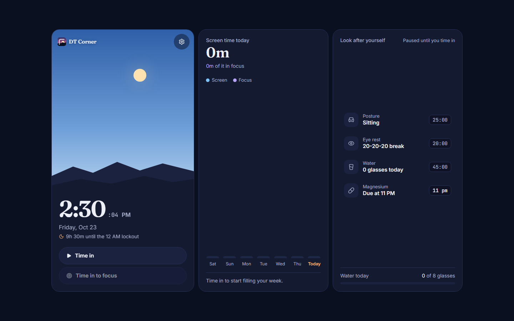
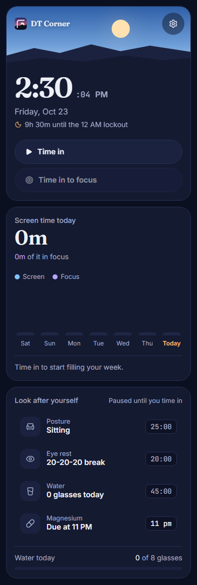

# DT Corner

A little helper for your desk. It tracks how long you've been on screen and nudges you to stand up, drink water, rest your eyes, and go to bed on time.

👉 **Try it:** [corner.denzeltl.com](https://corner.denzeltl.com/)

## Screenshots

|                     Desktop                      |                    Mobile                    |
| :----------------------------------------------: | :------------------------------------------: |
|  |  |

## What it does

- **Time in / time out:** tracks your screen time each day.
- **Weekly chart:** shows your screen and focus time for the last 7 days.
- **Sit / stand reminders:** sit for 25 minutes, stand for 15.
- **Focus timer:** 25 minutes of work, then a 5-minute break.
- **Water and eye-rest reminders:** aim for 8 glasses a day, and look away from the screen every 20 minutes.
- **Supplement check-in:** a daily reminder (like magnesium).
- **Bedtime lock:** after 11 PM, 12 AM or 1 AM (you pick), the screen locks until 5 AM.
- **No account needed:** everything is saved in your browser.

## Run it yourself

You need [Node.js](https://nodejs.org/) 18 or newer.

```bash
git clone https://github.com/denzeltl/dt-corner.git
cd dt-corner
npm install
npm run dev
```

Then open [http://localhost:5173](http://localhost:5173).

## Windows desktop app

The desktop version can time you in and out on its own when you stop using your keyboard and mouse. It only checks *how long* you've been idle, never what you type or which apps are open.

1. Install [Rust](https://www.rust-lang.org/tools/install) and the **Desktop development with C++** tools from Visual Studio.
2. Run `npm run tauri dev`.
3. In **Settings**, turn on **Auto tracking**.

To make an installer, run `npm run tauri build`. You'll find it in `src-tauri\target\release\bundle\nsis\` (a `setup.exe`) or `...\bundle\msi\`. Double-click it to install.

> If PowerShell says "running scripts is disabled", use `npm.cmd` instead of `npm`.

## Built with

React, TypeScript, Vite, Tailwind CSS, and Tauri (for the desktop app).

## To do

- [ ] Weekly and monthly reports you can export
- [ ] More detailed weekly chart
