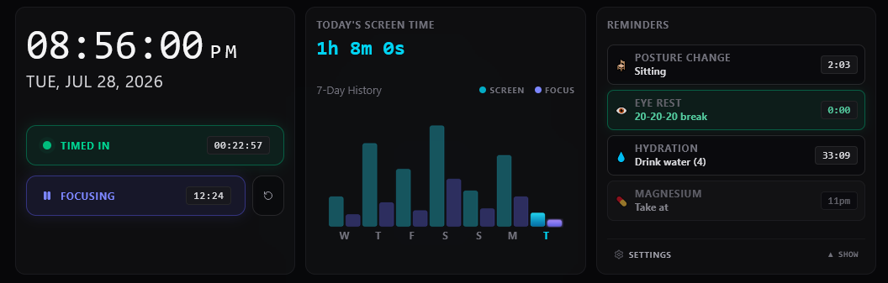

# DT Corner — Desk Health & Focus Tracker

DT Corner is a desktop screen and productivity tracker built as a modern web application. It helps you stay healthy and focused by managing work session timing, sit-stand posture switching, hydration goals, eye strain breaks, daily supplement reminders, and focus pomodoros — complete with a late-night lockdown mode to prevent burnout.

---

## 📸 Screenshot

|                      Dashboard                      |                      Lockdown Mode                      |
| :-------------------------------------------------------------: | :-------------------------------------------------------------: |
|  |  |

---

## 🚀 Key Features

- **Work Session Tracker:** Time in and time out to track your daily work hours.
- **Visual Analytics Dashboard:** SVG chart displaying daily logged work hours over the past 7 days with HR/MIN formatting.
- **Sit / Stand Ergonomic Timer:** Alternates between 25-minute sitting and 15-minute standing intervals with status indicators and sound reminders.
- **Pomodoro Focus Timer:** Integrated 25-minute focus work and 5-minute break timer with play, pause, and reset controls.
- **Hydration & Eye Rest Reminders:** Timers to remind you to drink water (with intake counter) and take 20-20-20 eye strain breaks.
- **Daily Supplement Tracker:** Quick daily check-in for supplements (e.g. Magnesium).
- **Bedtime Lockdown Mode:** Restrictive screen activated after 12 AM to discourage late-night work overload and enforce proper rest habits.
- **Web Audio & Push Notifications:** Synthesized audio cues via Web Audio API alongside optional browser push notifications.
- **Local-First Persistence:** Complete data persistence using `localStorage` — no login or backend service required.

---

## 🛠️ Tech Stack

- **Core Framework:** [React](https://react.dev/) (v19) with [Vite](https://vite.dev/) & [TypeScript](https://www.typescriptlang.org/)
- **Styling:** [Tailwind CSS](https://tailwindcss.com/) (v4)
- **Icons:** [Lucide React](https://lucide.dev/) for crisp, scalable icon assets
- **Audio Synthesis:** Web Audio API for custom chime, success, and alarm sound effects
- **Linter & Code Tools:** [Oxlint](https://oxc.rs/) for high-performance linting

---

## 📦 Getting Started

### Prerequisites

- Node.js (v18+ recommended)
- npm / yarn / pnpm

### Installation

1. **Clone the repository:**

    ```bash
    git clone https://github.com/denzeltl/dt-corner.git
    cd dt-corner
    ```

2. **Install dependencies:**

    ```bash
    npm install
    ```

3. **Run the development server:**

    ```bash
    npm run dev
    ```

    Open [http://localhost:5173](http://localhost:5173) in your browser to see the application.

---

## 📝 TODO Section

- [ ] **Weekly & Monthly Health Reports:** Provide exportable productivity and posture summaries.
- [ ] **Detailed Weekly Charts:** Instead of one bar, make multiple bars for hours and mins. 
