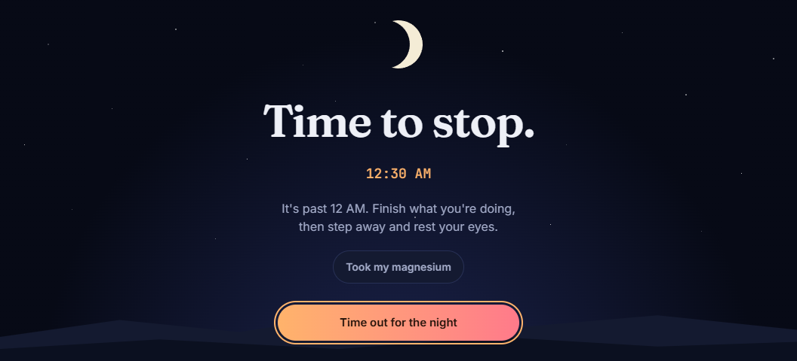

# DT Corner — Desk Screen & Productivity Tracker

DT Corner is a desktop screen and productivity tracker built as a modern web application. It helps you stay healthy and focused by managing work session timing, sit-stand posture switching, hydration goals, eye strain breaks, daily supplement reminders, and focus pomodoros — complete with a late-night lockdown mode to prevent burnout.

View project [here](https://dt-corner.vercel.app/)

---

## 📸 Screenshot

|                       Dashboard                       |                   Lockdown Mode                    |
| :---------------------------------------------------: | :------------------------------------------------: |
|  |  |

---

## 🚀 Key Features

- **Work Session Tracker:** Time in and time out to track your daily work hours.
- **Dusk Sky Clock:** The clock card's sky follows the real hour. The sun sets as your bedtime lockout gets closer, and the moon rises once it starts.
- **Weekly Chart:** Screen and focus time for the last 7 days, with exact values on hover or keyboard focus, plus a weekly total and daily average.
- **Sit / Stand Ergonomic Timer:** Alternates between 25-minute sitting and 15-minute standing intervals with status indicators and sound reminders.
- **Pomodoro Focus Timer:** Integrated 25-minute focus work and 5-minute break timer with play, pause, and reset controls.
- **Hydration & Eye Rest Reminders:** Timers to remind you to drink water (with an 8-glass daily goal) and take 20-20-20 eye strain breaks. Both intervals are adjustable in Settings.
- **Daily Supplement Tracker:** Quick daily check-in for supplements (e.g. Magnesium).
- **Bedtime Lockdown Mode:** A full-screen lockout from 11 PM, 12 AM or 1 AM (your choice) until 5 AM, to stop late-night work.
- **Web Audio & Push Notifications:** Synthesized audio cues via Web Audio API alongside optional browser push notifications.
- **Local-First Persistence:** Complete data persistence using `localStorage` — no login or backend service required.
- **Desktop Auto Tracking:** In the Windows desktop build, an opt-in system idle monitor can time in after activity and time out after a configurable period without keyboard or mouse input. The idle stretch is taken back off your screen time. If you come back within 4 hours on the same day, your session resumes with its timers instead of starting over. It reads only the idle duration, never keys, mouse coordinates, or active app names.
- **Fits Any Screen:** Three columns on landscape screens, a compact strip for short desk windows (e.g. 1056×340), two columns on vertical monitors and tablets, and one column on phones.

---

## 🛠️ Tech Stack

- **Core Framework:** [React](https://react.dev/) (v19) with [Vite](https://vite.dev/) & [TypeScript](https://www.typescriptlang.org/)
- **Styling:** [Tailwind CSS](https://tailwindcss.com/) (v4), with design tokens in `DESIGN.md` and `src/index.css`
- **Fonts:** Fraunces, Inter and JetBrains Mono, self-hosted with [Fontsource](https://fontsource.org/) so the desktop app works offline
- **Icons:** [Lucide React](https://lucide.dev/) for crisp, scalable icon assets
- **Audio Synthesis:** Web Audio API for custom chime, success, and alarm sound effects
- **Linter & Code Tools:** [Oxlint](https://oxc.rs/) for high-performance linting

---

## 📦 Getting Started

### Prerequisites

- Node.js (v18+ recommended)
- npm / yarn / pnpm

### Installation

1. **Clone the repository:**

    ```bash
    git clone https://github.com/denzeltl/dt-corner.git
    cd dt-corner
    ```

2. **Install dependencies:**

    ```bash
    npm install
    ```

3. **Run the development server:**

    ```bash
    npm run dev
    ```

    Open [http://localhost:5173](http://localhost:5173) in your browser to see the application.

### Windows desktop app

The browser version cannot inspect activity outside its own tab. The bundled desktop version uses Windows' system idle timestamp, so work in any desktop application counts as activity.

1. Install the [Rust MSVC toolchain](https://www.rust-lang.org/tools/install) and the **Desktop development with C++** workload from Visual Studio Build Tools.
2. Start the desktop app with `npm run tauri dev`.
3. Open **Settings** and turn on **Auto tracking**. Choose the idle time-out period (5–30 minutes).

To use the DT Corner icon in the desktop app, run `npm run tauri icon brand/app-icon-1024.png` once before building.

Use `npm run tauri build` to create an installer. The desktop app must be running to monitor activity; it does not record input content, screen contents, or which applications are open.

---

## 🎨 Brand

Logos, the favicon set, app icons and the social preview image are in `brand/` and `public/`. Open `brand/index.html` for usage notes.

---

## 📝 TODO Section

- [ ] **Weekly & Monthly Health Reports:** Provide exportable productivity and posture summaries.
- [ ] **Detailed Weekly Charts:** Instead of one bar, make multiple bars for hours and mins.
- [x] **Automated Monitoring:** Auto log in and log out based on inactivity.
